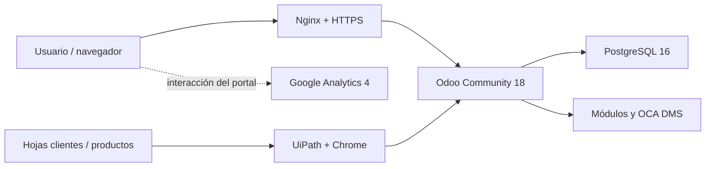

<div align="center">

# 🛍️ QuetzalMart — operación comercial e inteligencia de negocios

**Integración de Odoo Community, automatización con UiPath y analítica con GA4**


[Descripción](#descripción) · [Arquitectura](#arquitectura) · [Manuales](#manuales-y-evidencia) · [Reproducción](#reproducción)

</div>

---


*Imagen de marca incluida en el proyecto. Las capturas de la aplicación se encuentran en los manuales.*

## Descripción

Proyecto de **Sistemas Organizacionales y Gerenciales 2, grupo 1**, orientado a integrar los procesos de una tienda mediante Odoo Community. Reúne configuración de módulos comerciales, datos de demostración, automatización de cargas por interfaz con UiPath, documentación operativa y análisis de interacción con GA4.

El trabajo se construye **sobre Odoo y sus módulos**, con infraestructura, configuración, scripts, robot y evidencia del equipo. El repositorio permite revisar cómo se relacionan la operación comercial, la automatización y la información para la gestión.

## Áreas funcionales

| Área | Alcance de la entrega |
| --- | --- |
| Operación comercial | Productos, contactos, CRM, cotizaciones, ventas y facturas. |
| Abastecimiento | Compras, recepción, inventario y ajustes. |
| Organización | Departamentos, puestos, empleados y contratos. |
| Canal digital | Portal web, comercio electrónico y contenido de marca. |
| Documentos y comunicación | Archivos mediante OCA DMS, correos y evidencias de operación. |
| Automatización | Proyecto UiPath para cargar clientes/productos mediante la interfaz de Odoo. |
| Analítica | Configuración, evidencias e interpretación de GA4 en el Manual 3. |

## Arquitectura



El entorno documentado utiliza una VM de Google Cloud con Ubuntu 24.04. Odoo, PostgreSQL y Mailpit se definen mediante Docker Compose; PostgreSQL permanece en una red privada de contenedores y Nginx proporciona la entrada web del despliegue descrito.

### Decisiones relevantes

- Una base PostgreSQL centralizada para el caso académico.
- Cargas RPA mediante la interfaz de Odoo, respetando la restricción del proyecto de no usar su API desde UiPath.
- Hojas de carga con los nombres `clientes` y `productos` requeridos por el ejercicio.
- Evidencias asociadas a los procedimientos y manuales correspondientes.
- Separación entre entregables versionados y credenciales/estado local de las herramientas.

## Manuales y evidencia

| Documento | Qué revisar |
| --- | --- |
| [Manual 1 — Instalación y operación](manual_1/Manual_1_Instalacion_y_Operacion.md) | Infraestructura, configuración, cargas, módulos y ejecución del robot. |
| [Manual 2 — Diagramas de procesos](manual_2/Manual_2_Diagramas_de_Flujo.md) | Recorridos y relaciones entre los procesos del negocio. |
| [Manual 3 — Inteligencia de negocios con GA4](manual_3/Manual_3_Inteligencia_de_Negocios_GA4.md) | Configuración analítica, capturas e interpretación del caso. |
| [Bloque 2 — Infraestructura](BLOQUE_2_INFRAESTRUCTURA.md) | Configuración de la VM y recursos del entorno de entrega. |
| [Bloque 3 — Odoo y PostgreSQL](BLOQUE_3_ODOO_POSTGRESQL.md) | Instalación, persistencia y configuración de servicios. |
| [Bloque 7 — GA4](BLOQUE_7_GOOGLE_ANALYTICS.md) | Configuración y evidencia del bloque analítico. |
| [Bloque 8 — RPA](BLOQUE_8_RPA.md) | Flujo, condiciones y evidencia de UiPath. |

Cada carpeta `manual_1/`, `manual_2/` y `manual_3/` incluye su versión PDF entregada. Las consultas de [consultas_sql/](consultas_sql/) ayudan a contrastar los datos de los procesos.

## Reproducción

### Revisar la entrega sin desplegar

```bash
git clone https://github.com/DavidVelasquez77/GEREN2_PROYECTO_G1.git
cd GEREN2_PROYECTO_G1
```

Comenzar por el Manual 1 y seguir desde allí los procesos y evidencias. La lectura de los manuales, diagramas, hojas y consultas no requiere iniciar la VM ni ejecutar el robot.

### Preparar un entorno propio

| Componente | Requisito |
| --- | --- |
| Infraestructura | Entorno Linux y Docker Compose; cuenta, permisos y acceso a la VM si se reproduce en Google Cloud. |
| Aplicación | Configuración Odoo, base y módulos según el Manual 1. |
| Robot | Windows, UiPath Studio compatible con `rpa/QuetzalMart_RPA/project.json`, Chrome y extensión de UiPath. |
| Analítica | Acceso al entorno GA4 que se usará para la práctica. |

1. Preparar la infraestructura y la configuración del servidor conforme al Manual 1.
2. Instalar los módulos y cargar los datos maestros en una base destinada a la práctica.
3. Revisar los flujos comerciales y contrastar las consultas de verificación.
4. Abrir el proyecto UiPath, revisar sus dependencias y adaptar las condiciones de ejecución al entorno propio.
5. Ejecutar las cargas con las hojas de prueba y validar los registros resultantes en Odoo.
6. Revisar GA4 y sus evidencias con el contexto de la propiedad y la ejecución utilizadas.

### Configuración del despliegue

`infra/docker-compose.yml` monta `./config/odoo.conf` y `./addons` relativos a su carpeta. El instalador `infra/deploy_odoo18.sh` prepara esas rutas en `/opt/quetzalmart` usando fuentes en `/tmp/quetzalmart-deploy`, además de configuración y secretos generados en el servidor. **Un `docker compose up` directamente desde un clon sin esa preparación no equivale al procedimiento de instalación.**

Revisar el dominio, rutas y operaciones del instalador antes de usarlo en una máquina de práctica. Los accesos incluidos en los manuales describen el entorno de la entrega; no garantizan que el servicio de demostración permanezca activo.

## Organización del repositorio

```text
infra/              Compose, configuración y scripts de operación
rpa/QuetzalMart_RPA/ Proyecto UiPath, flujo y dependencias
datos/              Archivos de carga y datos de demostración
consultas_sql/      Validaciones y consultas por proceso
manual_1/           Instalación y operación
manual_2/           Diagramas de procesos
manual_3/           Inteligencia de negocios con GA4
capturas/           Evidencias de los procedimientos
assets/             Recursos de marca y productos
spreadsheet_work/   Auxiliares para preparar hojas
```

## Herramientas auxiliares y validación

Los scripts de `spreadsheet_work/` usan `@oai/artifact-tool`, un runtime privado del entorno de generación, y rutas del equipo original. **La generación auxiliar de hojas y la operación de Odoo son procedimientos distintos.** Las hojas entregadas se pueden inspeccionar sin ese runtime; regenerarlas requiere disponer de él y adaptar las rutas. El repositorio no proporciona una instalación npm pública de esa herramienta.

Para verificar el sistema, contrastar registros creados en Odoo, consultas SQL, resultado de los flujos RPA y evidencia de GA4 con los manuales. Las capturas corresponden a ejecuciones documentadas y no sustituyen una nueva validación del entorno. La regeneración de hojas con el runtime privado queda sujeta a comprobación del equipo.

## Equipo y créditos

Entrega colaborativa del **grupo 1**. Se conservan la autoría de los manuales, recursos y automatizaciones, así como los avisos de los componentes de terceros. Odoo, OCA DMS, UiPath y las plataformas de infraestructura mantienen su propia procedencia y condiciones de uso.
